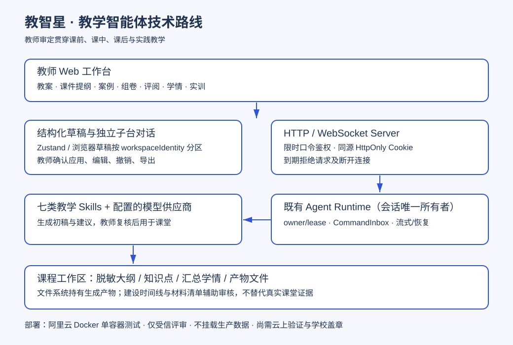
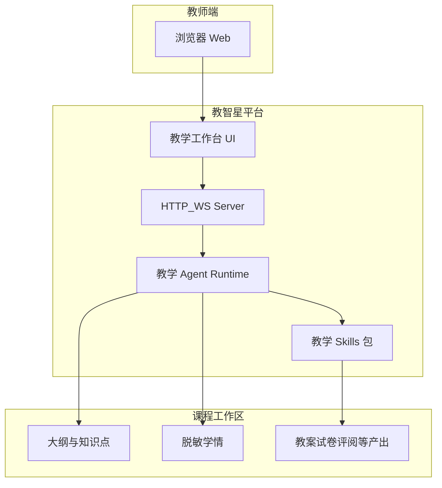

# 技术路线图

下列 Mermaid 是可编辑源：

## 说明

1. 交互层：Web 会话与文件预览。  
2. 智能层：教学人设 + Skills 路由。  
3. 数据层：工作区文件；演示数据脱敏。  
4. 部署层：Docker Compose + 访问令牌（见 `docs/deploy-aliyun.md`）。

> 匿名版：已去除或改为占位符的个人信息（姓名、工号、班级真名等），供专家评审使用。
