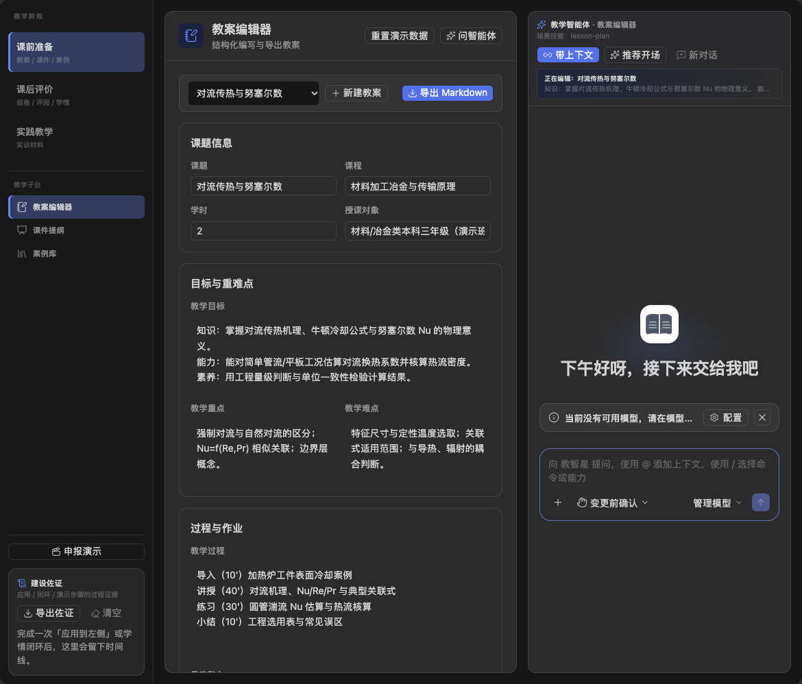
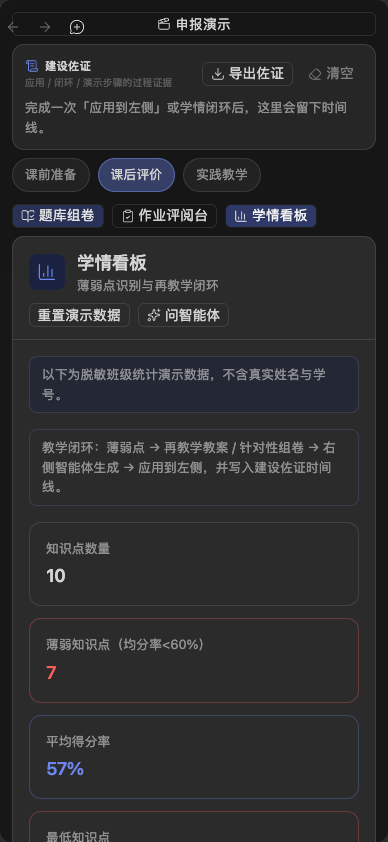

# 应用案例（虚构演示，尚非真实课堂证据）

材料编号：CASE-DEMO-01。课程：《材料加工冶金与传输原理》。不含真实学校、教师、学生或企业身份。

## 课前与课中

任务：围绕 K02“对流传热与努塞尔数”设计 2 学时教案、课件提纲、工程讨论题和随堂练习。
输入：课程大纲、知识点表及虚构换热场景。
操作：教案子台审定目标与重难点；智能体完成初稿后确认应用；课件子台组织页序与互动问题。课堂由教师核查 Nu/Re/Pr 的适用条件、物理含义和单位，使用案例讨论发现理解偏差。
可复核产物：教案 Markdown、讲稿提纲、讨论题。实际模型输出与课堂使用截图须另附，不能用本案例文字当作已执行证据。

## 课后与再教学

演示统计中 K06“凝固过程传热”为 51%，K07“加热炉热平衡”为 47%。统计文件为虚构示例，不能推断真实学生能力。
操作：在学情子台查看薄弱点；触发“再教学教案”或“针对性组卷”；教师核验知识点映射、题目与评分细则，审定后使用。
作业：只使用 A01 等演示别名，建议分不直接写入教务成绩系统。实际案例须附教师修订前后版本、评分核对与使用日期。

## 实验实训

任务：编制加热炉热平衡实训指导书、设备清单、实验记录表、风险提示及评分量表。教师/实验室负责人核查安全步骤，智能体建议不替代操作规程。

## 实际试点待补

课程与日期、授权依据、匿名样本编号、教师审定记录、课堂过程截图、真实产物、成效指标、反馈及学校审核意见。匿名截图裁去账号、姓名、路径、头像与真实班级标识。

## 实际工程截图（非课堂成效）

以上为 2026-10-03 真实浏览器 UI 验证，所有数据均为虚构演示。没有模型配置，因此不是实际模型生成或课堂实施截图。
