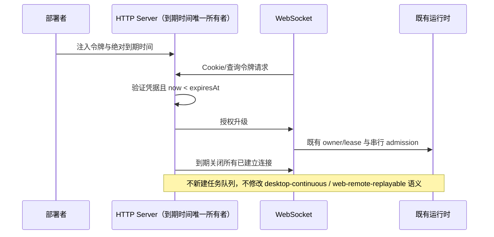

# 教智星 Web 部署规格（阿里云）

## 目标形态

单机 Docker Compose：HTTP 静态 Web + Server（WS/API）+ 挂载脱敏演示工作区。本期交付脚本与文档，不在仓库内写入真实主机凭据。

Web 部署构建使用 `pnpm build:jzx`（发行构建器的 `--runtime-only` 模式），直接生成 `dist/jzx/bin`、`server`、`agent`、`web`、`node_modules`，不要求下载分发服务器 URL，不将 tar 发布目录误当作运行目录，也不下载其他平台的 TUI 资源。镜像使用锁文件安装失败即终止，不回退重新解析依赖。旧跨平台 CLI 发行命令仍保留原语义。

## 运行参数

| 项 | 约定 |
| --- | --- |
| 监听 | `0.0.0.0`，宿主机端口默认 `8080` → 容器 `3030` |
| 工作区 | 挂载 `demo/jiaozhixing-course` |
| 访问控制 | `JZX_SERVER_AUTH_TOKEN`（必填于公网） |
| 模型 | 通过环境变量注入 Provider API Key（不入库） |

## 测试访问说明（须对外提供）

- 公开 URL：`http://<公网IP或域名>:8080`
- 访问令牌：由 `scripts/gen-test-access.mjs` 生成
- 二维码：同脚本生成真正 PNG，指向带 token 的访问链接；生成失败须明确报错，不以普通 SVG 文字冒充二维码。
- 权限：令牌持有者拥有部署容器内 Agent、文件和终端能力；不是多租户只读访客账号。只挂载脱敏演示工作区，不挂载宿主目录、Docker socket、学校数据库或企业资源。公网测试限受信评审，不宣称工作区路径是安全沙箱。
- 有效期：默认自生成起 30 天，生成私有 `access.env`，含令牌及 `JZX_SERVER_AUTH_EXPIRES_AT`（UTC ISO 时间）；Compose 必须传递两者。HTTP/WS 升级请求在到期时立即拒绝；既有 WS 在到期时关闭。到期不撤销已提交运行，运维另行停止容器/任务。服务端是有效期唯一所有者，文档不代替鉴权。
- 非法日期、弱占位令牌或缺失到期时间时公网部署拒绝启动；开发模式可不设置到期时间。令牌不输出到构建日志，私有访问产物权限为 0600。

## 鉴权事件与所有者

验收包括错误/缺失/到期令牌拒绝，Cookie 编码正确，既有 WS 到期断连，30 天到期不发生定时器整数溢出。公开测试 URL 和账号必须部署并实际验证后才能填写。

## 教师测试登录

无凭据打开 Web 首页时展示教智星限时测试登录表单，而不是 WebSocket 启动失败。口令仅由 Web 表单短期持有，提交到同源 `POST /api/test-access` 的 Authorization header；服务端复用同一凭据/到期策略，成功写 HttpOnly Cookie，失败显示“凭据无效或已过期”。不持久化口令到 localStorage，不连接第三方 OAuth。URL 扫码入口仍兼容，启动后移除查询参数中的 token。桌面 OAuth 和分享页保持既有独立路由。

交互 E2E：无凭据显示表单；错误凭据不进入工作台；正确凭据进入教学工作台；七子台可导航；移动端可以切换阶段和编辑；教案编辑刷新保留；登出/到期后再次访问返回表单。

## 验收

1. `docker compose -f deploy/docker-compose.yml up` 本机构建可启动（允许跳过完整 agent 二进制时使用开发替代说明）。
2. `docs/deploy-aliyun.md` 覆盖安全组、Docker 安装、compose、令牌轮换、可选 Nginx HTTPS。
3. 生成物含：访问说明 Markdown + 二维码 PNG 路径说明。

## 本地开发入口统一鉴权

开发服务器通过 packages/server/dev-server.mjs 异步读取仓库私有 deploy/access-output/access.env；文件缺失则停止启动，不静默退回无鉴权。5173 的 API/WS 代理和 3030 共用 HTTP Server 的凭据及到期策略，浏览器已登录时 Cookie 可继续访问，未登录的新上下文必须显示测试登录。轮换凭据后重启服务，旧 Cookie 失效。

生成器仅在显式 --local-simple-password 且 URL 为 localhost/127.0.0.1/[::1] 时接受至少 6 位的手工口令；公网保持至少 24 位随机令牌规则。口令只保存在忽略的私有访问产物中，不写入源码。已有到期时间在此次轮换中保留。

验收：两个入口分别在独立浏览器上下文测试无凭据、错误凭据、正确凭据和刷新；旧凭据拒绝；本地短口令可生成，公网短口令拒绝。
