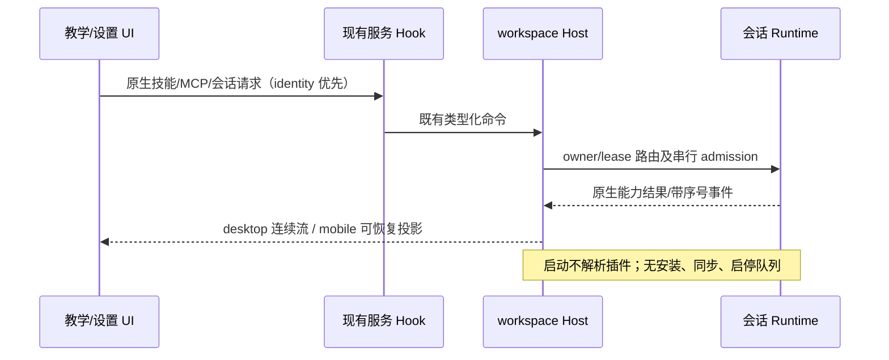

# 移除产品插件体系

教智星移除插件商店、市场来源、插件安装/恢复/升级/卸载/启停/配置、远程插件同步、插件引用选择与推荐、插件命令及插件运行时发现/加载。删除专用UI、store、hook、service、Agent协议、CLI命令、loader、插件配置schema与持久化写入路径、内置插件包/种子/下载缓存逻辑、构建打包和文档/技能指令中的对应引用。

通用Agent的独立技能、课程与办公skills、直接配置的MCP服务器、subagent、workspace hooks、教学画布/A2UI、PPT与其他办公文件生成继续由现有唯一owner提供，不依赖插件对象或插件来源。技能/agent/hook/MCP原生扫描取消插件元数据和加载通道。迁移不删除用户目录的历史文件；旧配置的插件字段不再被读取或执行，旧消息里的插件引用不产生安装或运行效果。

构建工具和UI库的技术plugin（Vite、ESLint、Lexical、Streamdown等）属于构建/渲染机制，继续用于编译、编辑器、公式与Mermaid；不作为可安装的产品插件功能。删除产品层插件协议方法，服务器/Agent不再提供插件操作。独立浏览器/Node工具按既有原生能力路径保留可用部分，不保留任何插件安装执行路径。

工作流：先补删除验收与边界清单，再删除模块和接线；共享公开入口、接口、路由、配置、打包同步收敛。owner/lease、Host连接、会话 admission与远控语义不改变；runtime仍由会话生命周期创建，移除启动插件解析阶段，不用空plugin服务或隐藏菜单代替删除。

验收：产品插件专用文件/入口/导出/命令与运行时loader不存在；CLI构建及实际启动/skills列表正常；web设置与对话无插件入口、推荐或选择器；教学开场、画布组件/PPT预览与办公skills回归；实际执行类型检查、Lint、全量架构及CLI/Web构建，记录失败及环境限制。

## 所有者与事件顺序

设置筛选属于组件局部状态；技能、MCP 配置仍分别属于原服务；生成内容继续属于教学 workspace 状态和会话 runtime。构建只暂存当前 CLI、独立 bundled-skills 与必要原生依赖；重建时清理旧编译插件副本。旧用户文件保留，但不提供运行和迁移入口。
