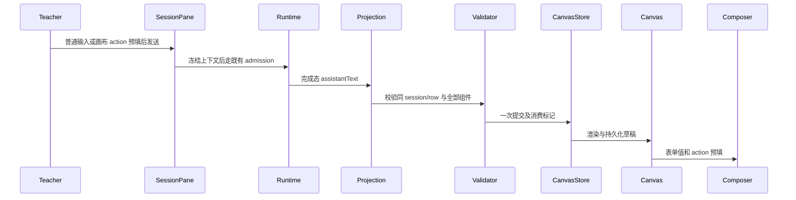

# 教学智能画布

右侧已有会话的完成态助手正文提供 jzx-ui JSON 围栏，或 mermaid/html 围栏，左侧同一教学子台自动显示画布。借鉴 open-jarvis 的声明式组件与 action 回传理念，使用教智星受控目录，集成 A2UI v0.9 官方消息校验与受控教学目录，非全目录客户端。支持其 a2ui_operations 中 createSurface/updateComponents 的完整组件树快照；v0.9 核心组件增量与数据更新能力见下文，未知消息明确拒绝。

组件目录：Column/Row/Card/Text/Markdown/Formula/Mermaid/Html/Table/Button/TextField。组件有唯一 id，root 根；容器通过 children id 引用。验证类型、长度、引用、环、深度、重复 id、按钮 prompt 等，完整验证后原子替换。每次一个 surface；单回复最多 100KB、80 组件、16 层。普通 Mermaid/HTML 围栏转为独立组件。非法内容保留旧画布并显示错误。

状态唯一所有者为 teachingCanvasStore：按 workspaceIdentity?.trim() || workspacePath + panel 分区；画布为教师本地草稿，localStorage 持久化，保留上一版供撤销。版本来源 sessionId + rowId（每行首次完成态），恢复历史不覆盖后来手工清空/撤销的版本，已消费标记随草稿持久化。会话切换或旧 projection 不匹配时不应用。流式中间态不提交。新对话保留左侧教学资产。远端 owner/lease 与两种实时语义不变，不另建服务端队列。

普通发送在 SessionPane 现有发送边界冻结教学上下文；可选 prepareUserText 仅作用普通用户消息，slash 命令不改写。上下文开关关闭仅去掉左侧数据，不去掉输出目录说明。画布表单和按钮只预填当前 composer，教师检查后发送，不自动开启新会话。用户可返回编辑器、查看源代码、撤销、清空；无模型时示例明确标识为示例，不声称真实生成。

HTML iframe 使用 sandbox=allow-scripts，无同源权限；CSP 阻止外网、嵌套 frame、表单提交和顶层导航；剔除自定义脚本与危险标签，只允许随机 nonce 的固定桥脚本，data-jzx-prompt 按钮/表单支持本地交互，postMessage 校验 source 等于当前 iframe.contentWindow，仅允许有界 action/resize，不接受任意命令。组件文字由 React 转义；Mermaid 复用 strict 渲染器。

验收：解析/拒绝测试涵盖环、非法引用、超长、unknown 类型、跨 surface 更新；E2E 以明确测试夹具模拟完成态入口，验证 Mermaid SVG、HTML 本地交互/宿主隔离/网络拒绝、表单 action 回传、上下文、刷新保留、子台隔离、撤销与重复恢复。真实模型生成需配置模型后另行核验。

源码视图支持教师粘贴完整 jzx-ui/Mermaid/HTML 回复并更新画布，和会话完成态共用 receive/验证入口，保留撤销；作为无模型环境的交互验收入口，不冒充模型执行。

## Markdown、数学公式与 A2UI 核心消息

新增 Formula(latex,displayMode) 目录项；Markdown.text 或 content 支持标题、列表、表格、代码、Mermaid 及 KaTeX 行内/块公式。接受 $...$、$$...$$、\\(...\\)、\\[...\\]；不改写代码围栏/行内代码中的分隔符。普通 markdown/md 围栏与无结构化围栏的完成态正文可生成 Markdown 画布，和原教学字段应用并存；仅在完整正文时提交。

使用 @a2ui/web_core 的 v0.9 A2uiMessageSchema 校验原生 a2ui_operations 消息；目录为教智星自定义 catalog（jzx-teaching），兼容之前简化快照输入。支持 createSurface、updateComponents（按组件 id 合并）、updateDataModel（有界 JSON Pointer 更新），一次回复中按序计算后整体验证并提交。跨 surface 更新、危险路径、未知目录、函数调用或组件类型拒绝且保留原稿。单子台一个 surface；不声称支持 A2UI 全部扩展。绑定 {path:"/topic"} 用于 Markdown/Text 的 text，由当前 dataModel 投影，数据更新不能另建状态所有者。其他组件字段沿用当前目录。

验收：Markdown 表格及公式真实 DOM/KaTeX 渲染；LaTeX 分隔符不污染代码；原生三类 A2UI 消息、组件增量合并与数据绑定更新；错误更新保留旧画布；刷新、撤销、移动布局与既有交互回归。模型未配置时继续使用明确的示例与测试回复。

浏览器验收等待 Mermaid 实际图节点完成渲染后操作相邻 HTML，避免异步图形布局变化干扰点击坐标。

HTML 自适应高度测量 body 的实际内容边界并包含 iframe 边框；不采用 documentElement.scrollHeight（包含 iframe 视口本身），避免滚动长画布时视口尺寸参与反馈导致预览布局不稳定。ResizeObserver 观察内容 body。

Web E2E 默认使用与当前 Playwright 版本匹配的 Chromium（先运行 `pnpm --filter @zcode/desktop exec playwright-core install chromium`）。可用 JZX_TEST_BROWSER_CHANNEL 显式选择系统浏览器；系统 Chrome 的 iframe 鼠标自动化未通过，配套 Chromium 已通过全套回归，不混淆两者结果。
