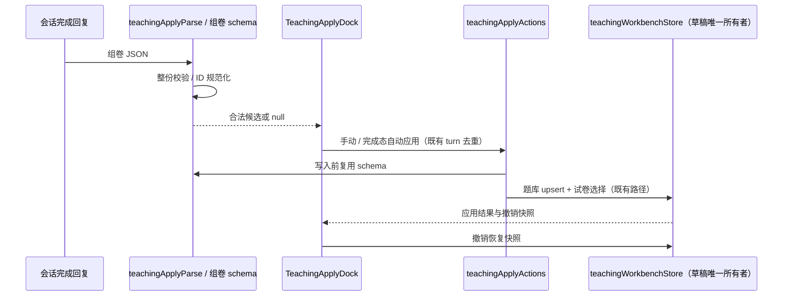
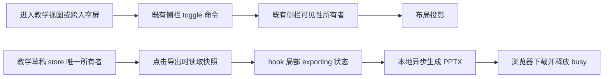
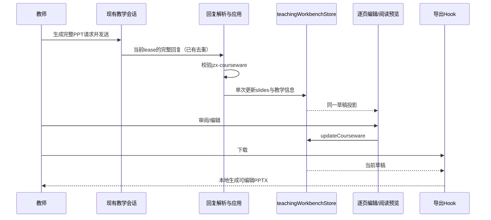

# 教智星产品级教学 UI 规格

## 目标

在 MVP（Agent Skills + 演示工作区）之上，提供独立教学工作台主视图，覆盖产品文案七大能力，含七个子台：

| 子台 | id | 阶段 | 职责 |
| --- | --- | --- | --- |
| 教案编辑器 | `lesson-editor` | 课前 | 结构化编辑教案并导出 Markdown |
| 课件 PPT | `courseware-editor` | 课前 | 编辑课件页序/互动点/讲稿摘要并导出 |
| 案例库 | `case-library` | 课前 | 编辑脱敏教学案例并导出 |
| 题库组卷 | `exam-builder` | 课后 | 维护小题库、按知识点/题型组卷并导出 |
| 作业评阅台 | `review-desk` | 课后 | 对脱敏作业给出建议分与反馈 |
| 学情看板 | `analytics-board` | 课后 | 脱敏知识点得分率、薄弱点与再教学/组卷动作 |
| 实训材料 | `lab-editor` | 实践 | 实验/实训指导书草稿并导出 |

## 导航与所有者

- **主视图**：扩展 `WorkspaceMainView` 增加 `teaching-workbench`（与 automations / plugin-store 同级）。
- **入口**：Workspace 侧栏「教学工作台」。
- **子台切换**：`TeachingWorkbench` + store 的 `activePanel`。
- **阶段映射**：
  - 课前准备 → 教案 / 课件 / 案例
  - 课后评价 → 组卷 / 评阅 / 学情
  - 实践教学 → 实训材料
- **教学领域数据**：`teachingWorkbenchStore`（Zustand）按 `workspaceIdentity \|\| workspacePath` 分区；持久化到 `localStorage`（键前缀 `jzx-teaching:`）。演示课程默认为《材料加工冶金与传输原理》；`seedVersion` 变更时刷新种子。文件系统仍为 Agent 产出事实源；本 UI 库是教师可编辑草稿层，可「导出到剪贴板 / 下载 Markdown」。
- **学情闭环**：薄弱点（均分率 < 60%）可展示再教学建议、跳转组卷并按知识点筛选、或 Ask Agent 深化分析。评阅结果不自动写回学情（演示数据分离）。
- **不直连** Repo/Service 实现；导出与种子数据在 UI 层完成。后续若接工作区文件读写，经 hooks → 公开服务契约。

## 子台内嵌对话（与主对话同能力）

每个子台页面必须同时包含：

1. **专用工具区**：既有结构化编辑器 / 看板（保持并可改进布局）。
2. **内嵌对话区**：复用主对话同一套构建块（`V4PaneConversationProvider` + `SessionPane` / Composer / Timeline / 附件 / 模型选择 / 流式输出），**禁止**仅跳转主对话或复制提示词的薄封装。

### 会话隔离与接线

- **作用域**：按 `workspaceIdentity \|\| workspacePath` + `TeachingPanelId` 隔离会话；切换子台不串话。
- **状态所有者**：`teachingPanelChatStore` 保存各子台当前 `sessionId` 与 pending prefill（内存态；删除会话后回草稿）。`paneId` 固定为 `teaching-<panelId>`，保证 draft prewarm 与主对话 / 分屏 pane 不冲突。教学草稿数据仍归 `teachingWorkbenchStore`。
- **创建与发送**：首条消息走与主对话相同的 draft prewarm → promote / createSession 路径；`onSessionCreated` 只写回该子台 session，**不得**切换 `workspaceMainView` 到 chat，也不得覆盖主区 `activeTaskId`。
- **场景绑定**：每个子台映射内置 skill（见下表）。「问智能体」与子台推荐 chips 将教师请求正文写入**本子台** composer（`requestComposerTextInsert`）；如当前子台已有会话，先回到该子台草稿再填入。技能 mention 在发送边界附加以便模型加载对应 skill，预填输入框不展示。

| 子台 id | 内置 skill |
| --- | --- |
| `lesson-editor` | `lesson-plan` |
| `courseware-editor` | `courseware-outline` |
| `case-library` | `case-mining` |
| `exam-builder` | `exam-paper` |
| `review-desk` | `homework-review` |
| `analytics-board` | `learning-analytics` |
| `lab-editor` | `lab-practicum` |

- **布局**：桌面宽屏为工具区 + 对话区左右分栏；窄屏上下堆叠。对话区标题标明当前子台场景，并提供「新对话」。
- **实现入口**：`TeachingChatPanel`（共享壳）由 `TeachingWorkbench` 按 `activePanel` 挂载。


## 左右联动（对话 ↔ 编辑器）

教学工作台不是「并排摆放」，而是双向协调：

| 方向 | 机制 | 所有者 |
| --- | --- | --- |
| 左 → 右 | 「带上下文」开启时，发送边界附带当前子台激活条目的 Markdown 摘要与输出格式提示（`teachingContext.ts`） | `teachingBridgeStore.includeContext` + `teachingWorkbenchStore` 只读快照 |
| 右 → 左 | 解析助手完成态正文中的导出同构 Markdown 或 ` ```jzx-*``` ` JSON 围栏（`teachingApplyParse.ts`），经「应用到左侧」或高置信自动应用写入草稿（`teachingApplyActions.ts`） | `teachingWorkbenchStore` 写；`teachingBridgeStore` 保存 undo / 字段高亮 |
| UI 反馈 | 应用后切换到目标子台、闪动更新字段、底部应用坞展示摘要与撤销 | `TeachingApplyDock` + `TeachingField.fieldId` |

### 应用语义（按子台）

- 教案 / 课件 / 案例 / 实训：更新当前激活条目；若无则新建。
- 组卷：解析题块写入题库并勾入试卷；可更新试卷标题。
- 组卷 JSON（`jzx-exam` / `jzx-exam-paper`）在 `teachingApplyParse` 入口整份校验，手动和自动应用共用该入口；`teachingApplyActions` 在任何草稿写入前复用同一 schema 校验。题目 `id` 接受非空字符串（去首尾空白）或有限数字（转字符串）；缺失、null、空白 ID 由现有应用路径生成。布尔、对象、数组 ID 拒绝，不用隐式字符串化掩盖非法结构。
- 题目必须包含合法题型、难度、字符串知识点 ID/标签、非空题干、字符串答案和有限正数分值；旧题型 `code` 仍映射为 `calc`。题目数组不能为空，规范化后重复的显式 ID 拒绝，避免静默覆盖。可选试卷标题必须为字符串。任何题目非法则整份拒绝，不部分写入，也不回退 Markdown 解析；回复正文仍可阅读。
- 状态所有者仍为 `teachingWorkbenchStore`；题库、试卷选择、持久化与撤销沿用已有写入路径，不新增状态或修改会话/远端协议。已保存的草稿不重置；兼容边界仅为生成回复的解析和应用。
- 评阅：按别名匹配或取首条作业，写入建议分与反馈。
- 学情：解析表格/列表薄弱点，替换演示统计草稿。

### 验收（联动）

1. 打开教案子台，开启「带上下文」，问「帮我完善教学目标」——输入框为短教学请求，发送时附带左侧当前教案摘要。
2. 右侧生成带 `## 教学目标` 等标题（或 `jzx-lesson` JSON）的回复后，出现「应用到左侧」；点击后左侧字段更新并闪动，可撤销。
3. 置信度 ≥ 约 72% 且面板匹配时自动应用一次（同一 turn 不重复）。
4. 七个子台均可完成「上下文注入 + 解析应用」闭环。
5. 组卷完成回复带数字 ID 时自动应用正常，题库与试卷使用同一字符串 ID；手动应用走同一路径，撤销恢复应用前的全部草稿。非法 ID、字段类型、空题目数组及重复 ID 不改变草稿，也不触发区域错误；带 Markdown 标题的非法组卷 JSON 不降级应用。桌面/窄屏 Web 均覆盖数字 ID 自动应用和撤销。

组卷回归入口：`pnpm exec tsx --tsconfig packages/ui/tsconfig.json --test packages/ui/test/teachingExamApply.test.ts`；浏览器场景：`node packages/web/test/teaching-exam-apply.e2e.mjs`。浏览器测试自启隔离 Vite，使用真实编辑器与应用坞，仅替换会话投影和文件 IO，不依赖模型或登录凭据。



## 验收

1. 侧栏可打开教学工作台；三阶段可切换并进入对应子台；默认直接进入教案编辑器。
2. 教案 / 课件 / 案例 / 实训均可编辑保存（刷新后仍在）并导出 Markdown；默认样例为传输原理语境。
3. 题库可增删题、按知识点筛选、勾选组卷、生成试卷预览与细目表；题型含单选/填空/简答/计算。
4. 评阅台可对样例作业（努塞尔数）填建议分与评语并保存。
5. 学情看板展示脱敏统计与薄弱知识点；薄弱点可「再教学建议 / 去组卷 / 请智能体分析」。
6. 「新建任务」草稿页（办公模式）展示教智星空态、场景 chips，以及优先排序的教学任务推荐卡片；点击推荐填入输入框。
7. 不出现职业引导、迁移引导、教学总览引导页（见 `NO_GUIDES.md`）。
8. 七个子台均展示工具区 + 内嵌完整对话；在子台对话发送消息可驱动与主对话同一 Agent 栈（流式、历史、附件/模型选择与主对话一致）。
9. 切换子台后各子台对话上下文相互独立；「问智能体」填入当前子台 composer，不离开教学工作台。
10. 左右联动：上下文注入与「应用到左侧」/自动应用/撤销在至少一个子台可演示，七子台解析路径可用。
11. `pnpm typecheck` / `pnpm lint` / `pnpm check:brand` 通过。

## 可编辑 PowerPoint 初稿导出

课件子台提供“下载 PowerPoint”按钮，浏览器本地生成 PPTX，不上传或自动调用模型。唯一输入是当前 `teachingWorkbenchStore` 的课件草稿；导出 hook 位于 `packages/ui/src/hooks`，不另存副本。包含封面、教学目标、按编号/Markdown 标题解析的课件页、互动活动与讲稿备注；纯文本保留，长正文自动分页，不静默截断。默认 16:9、深色封面、暖白正文底色、铜色页码标记，文字与形状均可在 PowerPoint 中编辑。没有正文的提纲页仍标为初稿，不能伪称完整自动授课课件。教师核查后使用。

导出期间禁用重复点击，失败显示提示，空提纲仍导出目标与互动页。验收包含有序页解析、长文本不丢失、下载文件为有效 PPTX、中文文本和讲稿备注保留，以及桌面/移动 Web 下载路径。

窄屏 Web 进入教学工作台或窗口跨入 <768px 时，复用既有侧栏可见性所有者收起全局侧栏；用户仍可从全局顶栏主动展开导航。侧栏开关不新增重复状态。工具区与对话区上下排列，工具至少占 50vh 并可滚动，整页可垂直访问两个区域；主内容宽度不被桌面 320px 下限与侧栏共同挤出视口。E2E 除点击导航外，检查工具区宽度与页面横向溢出，避免“按钮可点击”冒充手机布局可用。



## 新建任务草稿页

- **空态**：`ConversationDraftEmptyState` 在办公模式使用教学问候、品牌徽标与备课/组卷/评阅/实训 chips。
- **推荐池**：`getRecommendedPromptPool(true)` 将 `teachingDraftSuggestedPrompts` 前置到办公推荐列表。
- **列表 UI**：`ConversationDraftSuggestedPrompts` 的 `list` 布局使用教学卡片网格（标题 + 提示词摘要），样式见 `draft-new-task.css`。
- **文案**：i18n 键 `chat.empty.teaching.*`、`chat.draft.teaching.*`。
- **状态所有者**：推荐项仍由既有 draft suggestion 容器负责选择与填入；本页不新增业务状态。

## 申报向增强（过程证据与闭环）

- **学情闭环**：薄弱点支持「生成再教学教案」「针对性组卷」——切换子台、预填带上下文的对话，并写入建设佐证。
- **建设佐证**：`teachingEvidenceStore` 记录 apply / 闭环 / 申报演示步骤；可导出 Markdown 时间线。
- **OBE 对齐**：教案含 `outcomeAlignment` 清单，导出与 apply 解析均支持。
- **申报演示脚本**：任务化 5 步走查（非引导页），入口在侧栏「申报演示」。
- **会话持久化**：子台 `sessionId` 写入 `localStorage`（`jzx-teaching-sessions:`）。

## 智能画布

左右联动扩展支持生成声明式界面、Mermaid、HTML，并在已有会话预填画布 action；规格与安全边界见 `TEACHING_CANVAS.md`。原教学字段应用/撤销仍独立保留。

## 教师可读预填与发送上下文分离

“问智能体”、推荐开场和学情再教学入口只把教学请求正文预填到 Composer；不提前放入 skill mention、整份题库、JSON 协议或组件目录。发送时仍由 SessionPane.prepareUserText 单一路径冻结技能、当前教学草稿与画布规则。上下文开关控制当前草稿/画布是否附带，不改写输入框。组卷上下文包括现有完整知识点清单，强调铸造凝固、加热炉、轧制和冶金反应器情境，不把已选四道示例题误当整门课程范围。无知识点筛选时覆盖课程清单；有筛选时优先筛选项。当前题干和答案只作参考，100 分试卷需重新规划，不能直接复制演示题凑卷。教案 OBE 输出要求仅用于教案子台。

验收：组卷“问智能体”输入框保留课程名、100分、细目表及教师版答案的短请求；不含技能、上下文分隔符、JSON、组件目录、现成题目答案。推荐开场与学情闭环同样遵守。发送组合函数仍包含现有知识点/左侧内容与受控画布规则，关闭上下文不泄露草稿。按当前课程知识点的事实填写，不声称已导入学校教学大纲。

## 完整课件 PPT（2026-10-03）

课件子台展示名为“课件 PPT”。TeachingCourseware 增加可选 slides 数组，每页包含 title、body、notes（字符串）；最多80页、标题120字、正文3000字、备注6000字。提纲与全局教学信息继续保留；slides 是逐页正文唯一事实，旧草稿不重置。没有 slides 时仍可下载提纲初稿，并明确提示需要补全正文。

“生成完整 PPT”只将当前课程和课题的教师请求填入右侧输入框；发送时隐藏上下文要求智能体返回 jzx-courseware JSON slides，包含讲授正文、专业案例、练习、解答和逐页讲稿。完整回复经现有会话 lease 和应用路径校验后写入工作台，同一撤销路径恢复。严格校验字符串和页边界，剔除 id/updatedAt，失败不部分更新。

逐页编辑支持标题、正文、备注及增删页；Markdown/公式阅读预览与导出均读取当前工作台数据。PPTX 保留可编辑文本和独立备注，正文过长自动分页，无静默截断；网页的 Markdown/LaTeX 是阅读预览，PPTX 正文采用教师填写的纯文本（不承诺 HTML/Mermaid/LaTeX 转为可编辑图形）。预览不是 Office 的像素级排版预览。



验收：解析完整页与逐页备注；拒绝无效页/保护条目标识；旧提纲继续导出；长正文分页保留；浏览器编辑页后刷新保持、预览公式、生成请求无内部协议、下载ZIP含正文与备注；手机无横向溢出。模型生成质量需另行人工审阅，E2E使用明确的回复夹具验证集成路径。
