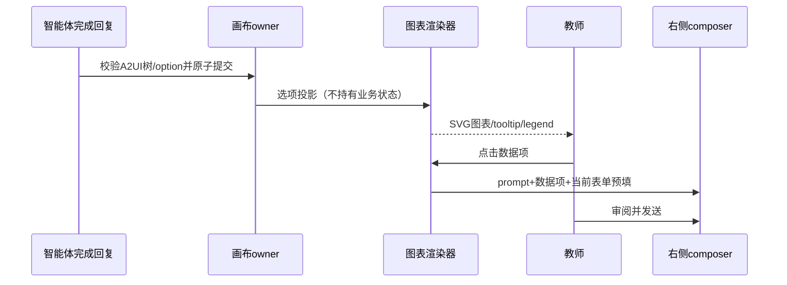

# 互动教学可视化组件

在现有 teachingCanvasStore 单一画布owner和官方A2UI事务协议上扩展目录，不改变Agent admission、workspace隔离与教师发送权限。新增 Grid、Heading、Badge、Stat、Progress、Divider、Select、Checkbox、ECharts；既有 Markdown/Formula/Mermaid/Html/Table/Button 保留。布局响应式、跟随主题与字号体系，支持 reduced-motion。

Grid(children,columns 1..4)手机单列；Heading(text,level 1..3)、Badge(label,tone)、Stat(label,value,description,tone)、Progress(label,value 0..100)、Divider；Select(label,options字符串数组)、Checkbox(label)表单值继续由canvas.values所有，提交按钮带全部控件值回右侧，由教师发送。卡片支持label/description/tone，支持标题与色彩层次。

ECharts(option为严格JSON对象,height 240..640,prompt可选)支持柱/线/饼/散点/雷达/仪表盘/热力/关系/桑基等内置图。也接受 echarts 围栏中的标准option对象。选项限制长度、深度、节点数及内置series类型，不接受函数、危险对象key或外部图像/URL，tooltip强制richText。渲染器懒加载，ResizeObserver适应尺寸，卸载销毁，旧异步加载不得更新新画布，错误显示明确提示。图形点击含prompt时通过既有prefill以教师可读的“数据系列/数据项/数值”和“是/否”表单值回传数据项，不自动发送；主题切换重建实例，减少动画偏好禁用动画。保留可读说明与统计依据，模拟数据明确标记，不冒充真实学情成效。

智能体发送上下文公布完整组件属性、图表JSON示例及选择规则：以互动教学页面组织内容，采用标题、指标卡、图表、流程、公式、表单和后续动作，图表与内容相关；不能只描述UI或返回孤立代码建议。保留教学字段围栏用于编辑和PPT生成。示例扩展为明确标注演示数据的教学仪表板，仍保留原有公式、Mermaid、HTML按钮与表格。

验收：schema接受目录与原生A2UI增量、拒绝异常图表/枚举/控件；echarts围栏与Markdown/Mermaid不丢文本；浏览器实际SVG图表可交互、控件回传/刷新恢复、切换页面、手机单列与主题/减少动画；回归已有教学画布、类型/Lint/架构/Web构建。

## 验证记录（2026-10-03）

12项画布单测与5项工作区单测通过。实际浏览器验证柱形、折线、环形、雷达、仪表盘、热力SVG渲染、图形点击与全部表单值回传、刷新恢复、原生A2UI组件增量更新、手机Grid单列和图表resize、减少动画偏好。原有画布、富内容画布、工作区/PPT及生产教学页面回归通过；这些测试使用明确标记的演示数据与已知回复，不冒充模型生成质量或课堂成效。

类型检查通过，Lint 0错误/70条原有警告，全量架构0违规，Web构建与品牌检查通过。仓库无origin/HEAD，freshness及Git增量检查不可用。ECharts生命周期及尺寸处理参照官方handbook；依赖6.1.0随应用打包，运行时不从CDN加载脚本。
