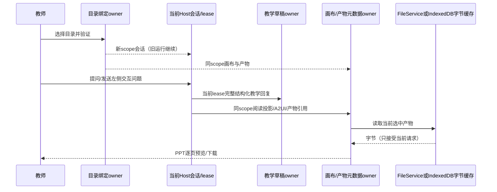

# 教学工作区、互动画布与产物预览

## 产品规则与状态边界

每个教学子页面右侧都有工作区选择入口。DirectoryBrowser 增加 opt-in 的 showSelectionActions，嵌入弹窗也可确认当前已加载目录；既有嵌入浏览场景保持默认不显示确认按钮。选择的是 Agent 执行端目录：桌面本地使用平台目录选择；Web/远端使用已有 DirectoryBrowser，经当前 Host fileService 验证可读取后提交。每个父工作区+panel 的目录绑定持久化在 teachingPanelChatStore；左右两侧统一使用选中 scope，默认继承父 scope。同一路径不同 remote identity 不能共享数据。目录切换不取消已接受运行、不迁移对话；新目录恢复该目录已有会话，或进入草稿。remoteSessionId 保留已有 attachment；远程 identity 的路径替换使用 shared 工具，不手写格式。

teachingWorkbenchStore 仍是教学可编辑数据唯一所有者，teachingCanvasStore 是 UI 阅读投影、A2UI表单及产物元数据唯一所有者。教学回复显示在画布：普通Markdown、公式与图表继续支持；jzx-lesson/courseware/case/exam/review/analytics/lab 转为可读标题、正文、页内容与讲稿；A2UI和教学结构同时返回时画布保留互动UI并附完整教学正文，不直接显示原始JSON。

左侧画布初始为主视图，编辑器可切换。初始阅读投影来自当前教学草稿，不另存副本。提供明确的“对话生成 → 画布更新 → 点击交互 → 产物预览”联动轨迹、卡片/按钮层次、组件入场与操作反馈；遵守 DESIGN 字号/主题及 reduced-motion。画布按钮/表单只将问题填入该 scope 右侧，由教师发送，不自动提交。

PPTX 产物采用已有 PptxPreviewContent，具备真实幻灯片渲染、缩略图、翻页与缩放。服务器产物通过现有 fileService 搜索/读取；会话完成时刷新当前workspace outputs目录（有界扫描），显式 jzx-artifacts/link 路径经范围校验后加入当前panel产物。支持PPTX、PDF、DOCX/XLSX、Markdown/HTML、图像，预览失败明确展示错误并允许下载原文件。拒绝外网URL、..路径穿越与工作区外路径；文件最大20MiB，服务器自身鉴权与路径权限不改变。

浏览器生成的PPTX先写入本地IndexedDB字节缓存，再由canvas owner登记产物并打开左侧预览，之后下载同一字节快照。产物元数据持久化，bytes缓存按随机artifact id索引；缓存是产物原始字节而非第二份课件草稿。读取失败允许重新生成，生成完成必须写入发起时的scope，不受切换影响。IndexedDB写入失败报告失败，不声称产物已保存。

## 时序与验收

旧lease残留投影不可写入新workspace；ChatPanel与ApplyDock随[panel,identity||path]重挂载，候选应用和画布接收同时验证lease.sessionId。Undo只能取当前workspace+panel的快照，不能撤销其他目录内容。

单测：绑定scope隔离/恢复、远程SSH/WSL/Docker identity保持authority、教学JSON可读投影、文本与图表不丢失、产物范围校验、异常回复保留现有UI。E2E：各页面目录按钮、两目录与两panel切换隔离及刷新恢复、真实A2UI按钮/字段回传、浏览器生成PPT→左侧真实预览与翻页/下载、服务器PPT展示、手机无页面横向溢出。类型/Lint/架构/构建真实执行。没有origin/HEAD时说明增量检查不可执行并运行全量检查。

## 本次验证记录（2026-10-03）

22项相关单测通过；教学工作台、智能画布、富内容画布及工作区/产物四组浏览器交互测试通过，包含实际PPTX翻页、缩略图、刷新恢复、服务器文件预览、两目录隔离、表单回传和390px手机布局。浏览器测试采用明确标注的教学回复夹具，不将其作为模型质量或真实课堂应用成效。

`pnpm typecheck`通过，`pnpm lint`为0错误/70条已有警告，全量架构检查0违规，Web生产构建通过，生产页面回归通过。当前仓库无origin且无HEAD，freshness与基于Git差异的增量架构检查无法执行，使用全量架构检查确认边界。

截图位于 `output/playwright/teaching-workspace-interaction.png` 与 `output/playwright/teaching-ppt-preview.png`。
